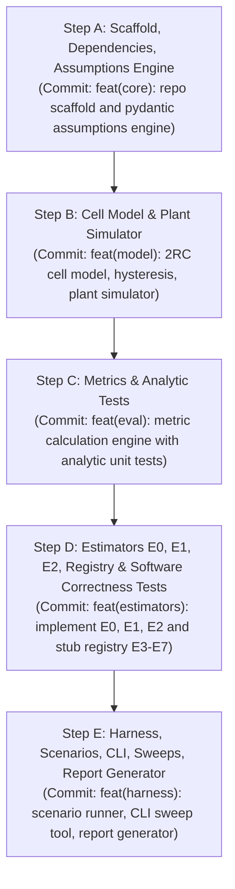

# PLAN.md: SOC Estimation Lab (Phases P0–P3) — Final Specification

## 1. Executive Summary & Specification Alignment

This plan defines the architecture, data structures, implementation sequence, and verification strategy for the **State-of-Charge (SOC) Estimation Lab** covering Phases P0 through P3 as specified in the project plan and overriding user instructions.

### Differences Between User Prompt and Original Project Plan (Prompt Takes Precedence)
1. **Session Scope (P0–P3 Only):**
   - *Plan:* Outlines seven phases (P0 to P6) with eight estimators (E0 to E7), full PyBOP fitting, real hardware logs from FlexiPod/CALCE, and MCU C-export.
   - *Prompt / This Session:* Strictly limited to P0–P3: repository scaffolding, central assumptions system, 2RC cell model and plant simulator, estimators E0, E1, E2, and the evaluation harness (metrics, runner, scenario loader, report generator). Estimators E3 through E7 are registered stubs that raise `NotImplementedError`.
2. **Central Editable Assumptions Hierarchy:**
   - *Plan:* Distributed cell parameters across `configs/cells/` and scenario overrides in `configs/scenarios/`.
   - *Prompt:* Mandates a unified assumptions engine under `configs/assumptions/`:
     - `base.yaml`: shared defaults
     - `profiles/automotive.yaml` and `profiles/bess.yaml`: profile-level overrides
     - `scenarios/*.yaml`: per-test scenario overrides
     - CLI `--set path.to.key=value`: highest-precedence override applied at runtime.
     - Every single assumption is an explicit object validated by Pydantic (`value`, `unit`, `status`, `bounds`, `note`) with `extra='forbid'`.
3. **Zero Cell Constants in Source Code:**
   - *Plan:* Mentioned config files in passing.
   - *Prompt:* Absolute rule: *No cell constant, noise value, threshold, or tuning gain may appear in source code.* Enforced via an automated AST test scanning `src/` using a strict allowlist `{0, 1, 2, -1, 3600, 1000, 60}` for neutral structural constants only.
4. **Derived Values:**
   - *Plan:* Allowed implicit RC parameters.
   - *Prompt:* Derived values (e.g., $C_j = \tau_j / R_j$) are computed in exactly one place dynamically from assumptions, never stored twice.
5. **Traceability & Sweeps:**
   - *Prompt:* Requires saving fully resolved config, its SHA-256 hash, and git commit next to results; reports must display counts of placeholder and assumed parameters; CLI must provide `soc sweep` to vary parameters and assess sensitivity.
6. **Synthetic Scenarios & Model Checks:**
   - *Prompt:* Synthetic test generation for T1, T3/T10, T4, T5, T6, T7, T9 plus an optimized `< 60s` smoke scenario running matched and mismatched variants. T1 is evaluated as a model OCV validation check, not an estimator tracking metric.

---

## 2. Target File Tree

```
SOC/
├── Makefile                          # Standard targets: test, smoke, lint, clean
├── pyproject.toml                    # Package metadata & build configuration (PEP 621)
├── requirements.txt                  # Pinned dependencies (numpy, scipy, pydantic, pyyaml, pytest, matplotlib)
├── requirements.lock                 # Frozen lockfile with exact package hashes/versions
├── README.md                         # < 1-page guide to assumptions, CLI, architecture, and E2 hysteresis details
├── configs/
│   └── assumptions/
│       ├── base.yaml                 # Base defaults across all groups (plant, duty, sensors, filter, etc.)
│       ├── profiles/
│       │   ├── automotive.yaml       # Dynamic automotive duty overrides (dynamic tuning, fast convergence)
│       │   └── bess.yaml             # Stationary BESS duty overrides (micro-cycles, long rests, drift tuning)
│       └── scenarios/
│           ├── smoke.yaml            # Fast smoke test (<60s runtime; runs matched and mismatched variants)
│           ├── t1_static_ocv.yaml    # Static OCV & hysteresis test (model-level validation check)
│           ├── t3_t10_minor_loops.yaml # Repeated partial cycles with reversals between SOC limits
│           ├── t4_plateau_stress.yaml# Plateau stress test (30-70% SOC holding)
│           ├── t5_initial_soc_offset.yaml # Initial SOC error convergence test (±5%, ±10%, ±20%)
│           ├── t6_current_bias.yaml  # Current-sensor bias & drift test
│           ├── t7_voltage_quant_noise.yaml # Cheap ADC quantisation & Gaussian noise
│           └── t9_rest_relaxation.yaml    # Rest & relaxation test (RC voltage relaxation at zero current)
├── data/
│   ├── splits.lock                   # Sealed train/val/test cycle split IDs
│   └── synthetic/                    # Pre-generated or cached synthetic test streams
├── src/
│   └── soc/
│       ├── __init__.py
│       ├── cli.py                    # Entry points: `soc run`, `soc sweep`, `soc report`
│       ├── assumptions/
│       │   ├── __init__.py
│       │   ├── schema.py             # Pydantic schemas: AssumptionEntry, Plant, Duty, etc. (strictly increasing OCV)
│       │   ├── loader.py             # Layered resolver (base -> profile -> scenario -> CLI --set)
│       │   └── derived.py            # Derived quantities (C1, C2, Ah->As conversions, noise generator seeds)
│       ├── models/
│       │   ├── __init__.py
│       │   ├── tables.py             # Multi-dimensional LUT interpolation (OCV(z, T), R(z, T), etc.)
│       │   ├── cell_2rc.py           # Core physics: 2RC states, 1-state hysteresis, terminal voltage
│       │   └── plant.py              # Forward simulator: truth state integration + shared noise realization
│       ├── estimators/
│       │   ├── __init__.py
│       │   ├── base.py               # Estimator Protocol, ParamSet, and SocEstimate dataclass
│       │   ├── registry.py           # Factory registry for E0..E7; E3..E7 raise NotImplementedError
│       │   ├── e0_coulomb.py         # E0: Coulomb counting + rest/full-charge OCV lookup
│       │   ├── e1_ekf.py             # E1: 2RC Equivalent Circuit + Extended Kalman Filter (tracks residual & NIS)
│       │   └── e2_ekf_hysteresis.py  # E2: E1 + 1-state hysteresis in EKF (tracks residual & NIS)
│       ├── harness/
│       │   ├── __init__.py
│       │   ├── perturbations.py      # Noise injection, bias, quantisation, dropouts (shared seeded Generator)
│       │   ├── generator.py          # Synthetic cycle generators driven purely by duty config
│       │   ├── scenario.py           # Scenario execution driver
│       │   └── runner.py             # Multi-scenario batch runner producing results CSV + metadata
│       └── eval/
│           ├── __init__.py
│           ├── metrics.py            # The 10 required metric calculators (pinned formulas & deadband)
│           ├── model_checks.py       # T1 model-level OCV validation check vs. reference
│           └── report.py             # Profile-aware bars, matched/mismatched labels, E2 vs E1 diagnostic, report footer
├── tests/
│   ├── __init__.py
│   ├── test_assumptions_schema.py    # Schema validation, bounds, unknown key rejection, strictly increasing OCV
│   ├── test_assumptions_loader.py    # Inheritance order: base -> profile -> scenario -> CLI override
│   ├── test_cell_model.py            # 2RC & hysteresis equations, table interpolation
│   ├── test_plant_simulator.py       # Plant simulator truth generation & shared noise realization
│   ├── test_metrics_analytic.py      # Analytic closed-form test cases for all metrics (including slope drift & inf)
│   ├── test_estimator_isolation.py   # Strict boundary test: estimators receive only measurements and estimator_model
│   ├── test_estimators.py            # E0, E1, E2 protocol adherence and stepping
│   ├── test_self_consistency.py      # Software correctness tests (a), (b), (c) with 0.05 pp (5e-4) tolerance
│   ├── test_sealed_split.py          # Enforces test-split secrecy from any tuning modules
│   ├── test_no_hardcoded_constants.py# AST scanner using explicit allowlist (0, 1, 2, -1, 3600, 1000, 60)
│   └── test_smoke_end_to_end.py      # Smoke scenario integration test verifying CSV & report generation
├── reports/                          # Generated CSVs, plots, and markdown reports
│   └── .gitkeep
```

---

## 3. Central Assumptions Schema & Configuration Groups

Every configurable parameter in the system is represented as an `AssumptionEntry[T]`:
```python
class AssumptionEntry(BaseModel):
    model_config = ConfigDict(extra="forbid")
    value: Any
    unit: str
    status: Literal["placeholder", "assumed", "measured", "fitted"]
    bounds: Optional[Tuple[float, float]] = None
    note: str
```

Validation guarantees:
- **Bounds enforcement:** Numeric entries enforce `bounds[0] <= value <= bounds[1]`.
- **Strictly increasing OCV:** The schema verifies that for every temperature slice in `ocv_table_v`, values strictly increase as SOC advances: $\mathrm{OCV}(z_{i+1}) > \mathrm{OCV}(z_i)$ for all $z_{i+1} > z_i$. This guarantees invertibility for E0 rest-anchoring.
- **Strict key checking:** Any unrecognized field in any YAML block is immediately rejected with a descriptive Pydantic error (`extra="forbid"`).
- **Status tracking:** Report footer scans all resolved parameters and counts `placeholder` vs `assumed` items.

### Configuration Groups
1. **`plant`**: True physical cell behavior.
   - `initial_soc`: True initial cell state of charge (e.g. 0.80).
   - `nominal_capacity_Ah`: Cell capacity $Q$ (Ah).
   - `coulombic_efficiency`: Charge coulombic efficiency $\eta$.
   - `temperatures_c`: Calibration temperatures for LUTs (`[15.0, 25.0, 35.0]`).
   - `soc_grid`: SOC breakpoints for LUTs (`[0.0, 0.05, 0.1, ..., 1.0]`).
   - `ocv_table_v`: 2D table of OCV values over `(temperature, soc)`. Validated strictly increasing in SOC.
   - `r0_table_ohm`: Ohmic internal resistance $R_0(T, z)$.
   - `r1_table_ohm`, `tau1_table_s`: First RC branch resistance and time constant $\tau_1$.
   - `r2_table_ohm`, `tau2_table_s`: Second RC branch resistance and time constant $\tau_2$.
   - `hysteresis_amplitude_v`: Hysteresis maximum half-voltage $M$.
   - `hysteresis_gamma`: Hysteresis progression rate $\gamma$.
   - *Note on Derived Values:* $C_1 = \tau_1 / R_1$ and $C_2 = \tau_2 / R_2$ are never stored in YAML; they are dynamically computed in `src/soc/assumptions/derived.py`.
2. **`duty`**: Operational duty cycle driving `generator.py` (prevents hardcoded constants in generator code).
   - `initial_soc`: Duty profile start SOC.
   - `ambient_temperature_c`: Test ambient temperature (e.g. 25.0 °C).
   - `pulse_c_rate`: Current magnitude for charge/discharge pulses (e.g. 1.0 C).
   - `pulse_duration_s`: Duration of individual current pulses (e.g. 60.0 s).
   - `rest_duration_s`: Rest period between pulses or test segments (e.g. 300.0 s).
   - `total_duration_s`: Overall profile execution duration.
   - `cycle_type`: Profile generator selector (`"pulse"`, `"knee_crossing"`, `"plateau_stress"`, `"dynamic_fuds"`, `"rest_relaxation"`, `"minor_loops"`).
   - `charge_discharge_ratio`: Ratio of charge to discharge periods.
   - `soc_min_limit`: Lower SOC limit for partial cycling / minor loops (e.g. 0.40).
   - `soc_max_limit`: Upper SOC limit for partial cycling / minor loops (e.g. 0.60).
3. **`estimator_model`**: The parameters the estimator believes.
   - Defaults to duplicating `plant`.
   - `mismatch`: Relative errors per parameter (`capacity_pct`, `r0_pct`, `ocv_offset_mv`, etc.) used for T12 robustness and the smoke test mismatched variant.
4. **`sensors`**: Sensor hardware imperfections.
   - `current_offset_a`: Fixed current sensor bias.
   - `current_gain_error`: Fractional gain error (e.g. 0.005 for 0.5%).
   - `current_noise_sigma_a`: Gaussian noise standard deviation $\sigma_i$.
   - `voltage_noise_sigma_v`: Gaussian noise standard deviation $\sigma_v$.
   - `voltage_quantisation_v`: ADC LSB quantisation step (e.g. 0.001 V = 1 mV).
   - `sample_period_s`: Measurement sampling time $\Delta t$.
   - `dropout_rate`: Sample drop probability.
   - `temperature_noise_sigma_c`: Temperature sensor noise $\sigma_T$.
5. **`filter`**: Estimator algorithm tunings and thresholds.
   - `initial_soc_offset`: Simulated starting SOC error (e.g. 0.05 for +5%).
   - `initial_soc_std`: Initial filter standard deviation $\sqrt{P_{0, \text{soc}}}$.
   - `initial_rc_current_std_a`: Initial standard deviation for $i_1, i_2$.
   - `initial_hysteresis_std`: Initial standard deviation for hysteresis state $h$.
   - `process_noise_q_soc`: Process noise variance for SOC integration.
   - `process_noise_q_rc`: Process noise variance for RC branch currents.
   - `process_noise_q_hysteresis`: Process noise variance for hysteresis state.
   - `measurement_noise_r_v`: Measurement noise variance for voltage observation.
   - `ocv_slope_weighting_gain`: Placeholder gain for future E5.
   - `convergence_threshold_2pct`: Convergence threshold for 2% (0.02).
   - `convergence_threshold_5pct`: Convergence threshold for 5% (0.05).
   - `reversal_min_current_a`: Current deadband threshold for detecting charge $\leftrightarrow$ discharge reversals (avoids noisy zero-crossing triggers).
6. **`soc_definition`**: Ground truth definition and anchoring policy.
   - `basis`: Basis for SOC reference (`"present_capacity"`).
   - `anchor_enabled`: Global boolean enabling full-charge/rest recalibration.
   - `rest_current_threshold_a`: Maximum current magnitude qualifying as rest.
   - `rest_duration_threshold_s`: Minimum duration at rest before OCV anchoring triggers.
   - `full_charge_voltage_threshold_v`: Voltage threshold for full-charge anchor.
   - `full_charge_current_threshold_a`: Taper current threshold for full-charge anchor.
7. **`bars`**: Pass thresholds from test matrix T1 to T14 (profile-specific; report reads from the active profile).
   - `t1_ocv_error_max_mv`: 5.0 mV.
   - `t2_dynamic_rmse_max`: 0.02 (2.0%).
   - `t2_dynamic_max_error`: 0.05 (5.0%).
   - `t3_bess_rmse_24h_max`: 0.02 (2.0%).
   - `t4_plateau_p95_max`: 0.03 (3.0%).
   - `t5_converge_time_s`: 60.0 s for automotive, 900.0 s for BESS.
   - `t6_drift_bess_per_day_max`: 0.01 (1.0%).
   - `t7_error_rise_max`: 0.01 (1.0 percentage point).
   - `t9_post_rest_step_error_max`: 0.02 (2.0%).
   - `t10_reversal_spike_max`: 0.03 (3.0%).
   - `t12_mismatch_rmse_rise_max`: 0.015 (1.5 percentage points).
   - `t14_auto_max_ms_per_step`: 5.0 ms.
8. **`run`**: Operational environment.
   - `random_seed`: Master integer seed (e.g. 42).
   - `splits_file`: Path to `data/splits.lock`.
   - `dataset_names`: List of active dataset identifiers.

---

## 4. Initial Assumptions & Clearly Marked Placeholder Values

In accordance with *"Do not guess any cell parameter. Ship clearly marked placeholder LFP values and say so wherever they are used"*, all cell parameters are assigned explicit `status: "placeholder"` tags:

1. **Cell Chemistry & Capacity:**
   - Chemistry: Prismatic Lithium Iron Phosphate (LiFePO4 / LFP).
   - Capacity $Q$: `100.0 Ah` (`status: placeholder`, `bounds: [1.0, 500.0]`, note: *"Placeholder nominal capacity for standard LFP prismatic cell"*).
   - Coulombic efficiency $\eta$: `0.998` (`status: placeholder`, `bounds: [0.8, 1.0]`).
2. **Strictly Increasing OCV Curve:**
   - Characteristic flat LFP plateau ($3.25\text{--}3.33\text{ V}$) over 20%–80% SOC, lower knee at 10% ($3.15\text{ V}$), upper knee at 90% ($3.36\text{ V}$), endpoints at 0% ($2.50\text{ V}$) and 100% ($3.65\text{ V}$).
   - Strictly monotonic: each successive SOC point has strictly greater voltage.
   - Populated at 15 °C, 25 °C, and 35 °C (`status: placeholder`, `bounds: [2.0, 4.0]`).
3. **2RC Internal Impedance:**
   - $R_0$: `0.001 Ohm` (1 mΩ) (`status: placeholder`, `bounds: [0.0001, 0.05]`).
   - $R_1$: `0.0006 Ohm` (0.6 mΩ), $\tau_1$: `15.0 s` (`status: placeholder`, `bounds: [0.00005, 0.05]`, `[0.5, 300.0]`).
   - $R_2$: `0.0009 Ohm` (0.9 mΩ), $\tau_2$: `60.0 s` (`status: placeholder`, `bounds: [0.00005, 0.05]`, `[1.0, 1200.0]`).
4. **Hysteresis Parameters:**
   - Half-amplitude $M$: `0.015 V` (15 mV) (`status: placeholder`, `bounds: [0.0, 0.1]`).
   - Progression rate $\gamma$: `50.0` (`status: placeholder`, `bounds: [1.0, 500.0]`).
5. **Duty Cycle Parameters (`duty` group):**
   - `initial_soc`: `0.80` (`status: placeholder`, `bounds: [0.0, 1.0]`).
   - `ambient_temperature_c`: `25.0` (`status: placeholder`, `bounds: [-20.0, 60.0]`).
   - `pulse_c_rate`: `1.0` (`status: placeholder`, `bounds: [0.01, 10.0]`).
   - `pulse_duration_s`: `60.0` (`status: placeholder`, `bounds: [1.0, 3600.0]`).
   - `rest_duration_s`: `300.0` (`status: placeholder`, `bounds: [1.0, 86400.0]`).
   - `total_duration_s`: `3600.0` (`status: placeholder`, `bounds: [10.0, 604800.0]`).
   - `cycle_type`: `"pulse"` (`status: placeholder`, note: *"Default synthetic pulse train"*).
   - `charge_discharge_ratio`: `1.0` (`status: placeholder`, `bounds: [0.1, 10.0]`).
   - `soc_min_limit`: `0.40` (`status: placeholder`, `bounds: [0.0, 1.0]`).
   - `soc_max_limit`: `0.60` (`status: placeholder`, `bounds: [0.0, 1.0]`).
6. **Sensor Quality & Reversal Deadband:**
   - Current bias: `0.0 A` (`status: placeholder`, `bounds: [-5.0, 5.0]`).
   - Current gain error: `0.0` (`status: placeholder`, `bounds: [-0.1, 0.1]`).
   - Current noise $\sigma_i$: `0.05 A` (`status: placeholder`, `bounds: [0.0, 2.0]`).
   - Voltage noise $\sigma_v$: `0.002 V` (2 mV) (`status: placeholder`, `bounds: [0.0, 0.05]`).
   - Voltage quantisation: `0.001 V` (1 mV) (`status: placeholder`, `bounds: [0.0, 0.05]`).
   - Sample period $\Delta t$: `1.0 s` (`status: placeholder`, `bounds: [0.01, 60.0]`).
   - Reversal min current threshold (`reversal_min_current_a`): `2.0 A` (`status: placeholder`, `bounds: [0.1, 50.0]`, note: *"Deadband threshold to filter sensor noise flips"*).
7. **Filter Tuning Defaults:**
   - $Q_{\text{soc}} = 10^{-7}$, $Q_{\text{rc}} = 10^{-5}$, $Q_h = 10^{-6}$ (`status: placeholder`).
   - $R_v = 2.5 \times 10^{-5} \text{ V}^2$ (`status: placeholder`).
   - $P_{0,\text{soc}} = 0.01$ (`status: placeholder`).

---

## 5. Cell Model, Shared Noise & Estimator Dynamics

### 5.1 Sign Convention & Dynamics
- **Discharge current is positive ($i_k > 0$).**
- SOC state update:
  $$z_{k+1} = z_k - \frac{\eta(i_k) \Delta t}{3600 \cdot Q} i_k$$
  with $\eta(i_k) = \eta_{\text{chg}}$ for $i_k < 0$, else $1.0$.
- 2RC branch currents:
  $$i_{j,k+1} = \exp\left(-\frac{\Delta t}{\tau_j}\right) i_{j,k} + \left(1 - \exp\left(-\frac{\Delta t}{\tau_j}\right)\right) i_k \quad (j \in \{1, 2\})$$
- One-state hysteresis ($h \in [-1, 1]$):
  $$h_{k+1} = \exp\left(-\left|\frac{\eta i_k \gamma \Delta t}{3600 Q}\right|\right) h_k - \left(1 - \exp\left(-\left|\frac{\eta i_k \gamma \Delta t}{3600 Q}\right|\right)\right) \mathrm{sgn}(i_k)$$
  *Properties (documented in docstring and README):*
  - $h$ is strictly bounded in $[-1, 1]$.
  - Initial value is $h_0 = 0$.
  - At zero current ($i_k = 0$), $h_{k+1} = h_k$ (hysteresis state is unchanged at rest).
  - Test T9 specifically evaluates RC voltage relaxation ($i_1, i_2 \to 0$), while $h$ remains static at rest.
- Terminal voltage:
  $$v_k = \mathrm{OCV}(z_k, T_k) + M \cdot h_k - R_1 i_{1,k} - R_2 i_{2,k} - R_0 i_k$$

### 5.2 Shared Seeded Noise Realization
- For each scenario, a single `numpy.random.Generator` is instantiated using a deterministic seed:
  $$\text{Seed} = \mathrm{hash\_combine}(\text{run.random\_seed}, \mathrm{SHA256}(\text{scenario\_config}))$$
- The plant simulator uses this generator once per scenario to produce corrupted measurements ($v_{\text{meas}}, i_{\text{meas}}, T_{\text{meas}}$).
- **Every estimator (E0, E1, E2) evaluates on the exact same noisy stream.**

### 5.3 Reversal Detection with Deadband
- A direction reversal is registered **only** when current crosses from $> +I_{\text{rev\_thresh}}$ to $< -I_{\text{rev\_thresh}}$ or vice versa. Transitions into or out of the deadband $[-I_{\text{rev\_thresh}}, +I_{\text{rev\_thresh}}]$ do not trigger reversals.

### 5.4 Estimator Implementations & Innovation Diagnostics
- **Strict Boundary Guarantee:** Estimators accept only measurements ($v, i, T, \Delta t$) and `estimator_model` parameters via `params: ParamSet`. Estimators cannot access or inspect the plant object, truth SOC, plant hidden states, or injected noise parameters.
- **E0 (Coulomb Counting + Rest OCV Inversion):**
  Integrates current. Anchors on rest or full-charge if `anchor_enabled=True`.
- **E1 (2RC + EKF without Hysteresis):**
  State $x = [z, i_1, i_2]^T$. Tracks filter covariance $P$, innovation $y_k = v_k - \hat{v}_k$, innovation covariance $S_k = H_k P_k^- H_k^T + R_v$, and records:
  - `voltage_residual_rmse`: $\sqrt{\frac{1}{N}\sum (v_k - \hat{v}_k)^2}$ (diagnostic)
  - `mean_NIS`: $\frac{1}{N}\sum \frac{(v_k - \hat{v}_k)^2}{S_k}$ (Normalized Innovation Squared, diagnostic)
- **E2 (2RC + EKF with 1-State Hysteresis):**
  State $x = [z, i_1, i_2, h]^T$. Tracks filter covariance, innovation, `voltage_residual_rmse`, and `mean_NIS`.
- **E3 to E7:** Registered classes raising `NotImplementedError("E<N> is scheduled for Phase 4")`.

---

## 6. Evaluation Metrics & Analytic Verification

Every metric is calculated by `src/soc/eval/metrics.py` against truth SOC $z^*$ and estimated SOC $\hat{z}$:

1. **RMSE:** $\sqrt{\frac{1}{N}\sum_{k=1}^N (\hat{z}_k - z_k^*)^2}$
2. **MAE:** $\frac{1}{N}\sum_{k=1}^N |\hat{z}_k - z_k^*|$
3. **max_abs_error:** $\max_{k} |\hat{z}_k - z_k^*|$
4. **p95_error:** 95th percentile of absolute error distribution.
5. **converge_time_2pct:** Smallest time $t_c$ (seconds) such that for all $t \ge t_c$, $|\hat{z}(t) - z^*(t)| \le 0.02$. **Returns `float('inf')` if never converged; report flags `inf` as FAIL.**
6. **converge_time_5pct:** Smallest time $t_c$ (seconds) such that for all $t \ge t_c$, $|\hat{z}(t) - z^*(t)| \le 0.05$. **Returns `float('inf')` if never converged; report flags `inf` as FAIL.**
7. **plateau_rmse_20_80:** RMSE evaluated strictly over samples where truth SOC $z_k^* \in [0.20, 0.80]$.
8. **post_reversal_error_60s:** Maximum absolute error observed in the 60 s window following a deadband-filtered reversal.
9. **drift_24h:** **Least-squares slope ($\beta$) of signed error $e_k = \hat{z}_k - z_k^*$ over time, scaled to 24 hours:**
   $$\mathrm{drift\_24h} = \beta \times (86400 \text{ s})$$
   Expressed in SOC units. If the scenario total duration is less than 24 hours, the runner marks the metric with an `extrapolated=True` flag in output metadata.
10. **ms_per_step:** Average CPU execution time per step in milliseconds.

*Diagnostic Columns (E1, E2):*
- `voltage_residual_rmse`: RMSE of voltage innovations.
- `mean_NIS`: Normalized Innovation Squared average.

### T1 Model-Check Function (`src/soc/eval/model_checks.py`)
- Test T1 is scored as a **model-level OCV validation check** comparing model OCV to reference OCV across the temperature grid ($\max |\mathrm{OCV}_{\text{model}} - \mathrm{OCV}_{\text{ref}}| \le 5\text{ mV}$), rather than an estimator tracking metric.

### Closed-Form Analytic Tests (`tests/test_metrics_analytic.py`)
- Constant error $e(t) = c$: Verifies RMSE = MAE = max_abs_error = p95_error = $c$, and slope `drift_24h = 0.0`.
- Linear error drift $e(t) = a \cdot t$: Verifies that least-squares slope yields exact drift $a \times 86400$.
- Step/exponential convergence: Verifies exact analytical convergence time to within 2% and 5%.
- Non-converging error sequence: Verifies that `converge_time_*` returns `inf`.
- Reversal with deadband: Verifies that noise jitter below $I_{\text{rev\_thresh}}$ is ignored while true crossing triggers the 60 s evaluation window.

---

## 7. Software Correctness Verification Strategy (Replaces Generic Self-Consistency)

In `tests/test_self_consistency.py`, explicit unit tests verify algorithmic implementation correctness. All cases are explicitly labeled:
**"software correctness, not accuracy evidence"**
Tolerance across all tests: **0.05 percentage points of SOC ($5 \times 10^{-4}$ absolute)**.

1. **Case (a) — Zero Initial Offset Stability (E0, E1, E2):**
   - E0, E1, and E2 started at the exact true SOC ($z_0 = z_0^*$) on noiseless data simulated from their own respective models.
   - Max absolute error over the run must remain $\le 5 \times 10^{-4}$.
2. **Case (b) — 10-Point Initial Offset Knee-Crossing Convergence (E1, E2):**
   - E1 and E2 started $10$ percentage points off ($z_0 = z_0^* + 0.10$).
   - Duty cycle: `cycle_type: "knee_crossing"`, discharging continuously from $30\%$ SOC down through the lower OCV knee ($< 15\%$ SOC).
   - E1 and E2 must converge to within $\le 5 \times 10^{-4}$ ($0.05$ percentage points) after crossing the knee.
3. **Case (c) — Initial Offset & Anchor Handling (E0):**
   - E0 started $10$ percentage points off with `anchor_enabled: false`: error must remain within $0.1$ percentage points ($1 \times 10^{-3}$) of the initial offset throughout current integration.
   - E0 started $10$ percentage points off with `anchor_enabled: true` and a scripted full-charge anchor event: error must correct to $\le 5 \times 10^{-4}$ immediately following the anchor event.

---

## 8. Source Code Purity: AST Scanner with Allowlist

`tests/test_no_hardcoded_constants.py` will parse the Python AST of every file under `src/soc/`.
- **Allowed Numeric Literals:** Strictly limited to structural integers:
  $$\{0, 1, 2, -1, 3600, 1000, 60\}$$
  (0, 1, 2, -1 for indices, loop bounds, neutral signs; 3600 for seconds/hour, 1000 for ms/s or mV/V, 60 for s/min).
- **Forbidden:** Any float literal, or any integer not in the allowlist.
- Any occurrence of forbidden numeric literals outside test suites and the YAML default loader raises an immediate test failure.

---

## 9. Scenarios Matrix for P0–P3

No scenarios other than the following will be added in this session:
1. `smoke.yaml`: Fast runtime ($< 60\text{ s}$). Evaluates each estimator under two conditions: **matched** model and **mismatched** variant (capacity and $R_0$ shifted via `estimator_model.mismatch`). Report labels every row `"matched"` or `"mismatched"`.
2. `t1_static_ocv.yaml`: Evaluated via `model_checks.py` for model OCV accuracy.
3. `t3_t10_minor_loops.yaml`: Repeated partial cycling with reversals between configurable SOC limits (`soc_min_limit: 0.40`, `soc_max_limit: 0.60`).
4. `t4_plateau_stress.yaml`: Plateau stress test (holding between 30% and 70% SOC).
5. `t5_initial_soc_offset.yaml`: Initial SOC offset convergence test.
6. `t6_current_bias.yaml`: Current-sensor offset and drift test.
7. `t7_voltage_quant_noise.yaml`: Voltage ADC quantisation and noise test.
8. `t9_rest_relaxation.yaml`: Rest and RC relaxation test (verifies $i_1, i_2 \to 0$ while $h$ remains unchanged).

---

## 10. Build Order & Commit Plan



### Step A: Scaffold & Assumptions System
- `pyproject.toml`, `requirements.txt`, `requirements.lock`, `Makefile`.
- `configs/assumptions/base.yaml`, `profiles/automotive.yaml`, `profiles/bess.yaml`.
- Pydantic models in `src/soc/assumptions/schema.py`:
  - `AssumptionEntry`, `PlantAssumptions`, `DutyAssumptions`, `SensorsAssumptions`, `FilterAssumptions`, etc.
  - Validation: bounds checks, strictly increasing OCV table check, `extra="forbid"`.
- Resolver in `loader.py` implementing `base` $\to$ `profile` $\to$ `scenario` $\to$ `--set`.
- Derived values in `derived.py` ($C_1, C_2$, Coulomb conversions, seeded generator helper).
- Unit tests: schema bounds, unknown key rejection, strictly increasing OCV validation, layered override hierarchy.
- *Commit:* `feat(core): repo scaffold and pydantic assumptions engine`

### Step B: Cell Model & Plant Simulator
- 2D LUT interpolation in `src/soc/models/tables.py`.
- 2RC physics and 1-state hysteresis in `src/soc/models/cell_2rc.py` (with documented properties: $h \in [-1, 1]$, $h_0 = 0$, $\Delta h = 0$ at $i = 0$).
- Forward simulator in `src/soc/models/plant.py`:
  - Truth state integration.
  - Generates corrupted sensor streams via single scenario-seeded `numpy.random.Generator`.
- Unit tests verifying dynamics, table lookups, and shared noise repeatability.
- *Commit:* `feat(model): 2RC cell model, hysteresis, and plant simulator`

### Step C: Metrics, Model Checks & Analytic Tests
- `src/soc/eval/metrics.py`: all 10 metrics with pinned formulas (least-squares 24h drift, `inf` for non-convergence, reversal deadband).
- `src/soc/eval/model_checks.py`: T1 OCV model vs reference check function.
- `tests/test_metrics_analytic.py`: analytic unit tests for every metric.
- *Commit:* `feat(eval): metric calculation engine with analytic unit tests`

### Step D: Estimators E0, E1, E2 & Registry
- `Estimator` Protocol, `ParamSet`, `SocEstimate` in `src/soc/estimators/base.py`.
- Architectural boundary test (`tests/test_estimator_isolation.py`): verifies constructors and `step()` accept only measurements and `estimator_model` parameters.
- E0 (Coulomb counting with rest/charge anchoring) in `e0_coulomb.py`.
- E1 (2RC + EKF without hysteresis; tracks `voltage_residual_rmse` and `mean_NIS`) in `e1_ekf.py`.
- E2 (2RC + EKF + 1-state hysteresis; tracks `voltage_residual_rmse` and `mean_NIS`) in `e2_ekf_hysteresis.py`.
- Registry in `registry.py` with E0..E2 registered, E3..E7 raising `NotImplementedError`.
- Software correctness tests (`tests/test_self_consistency.py`): Cases (a), (b), (c) with $5 \times 10^{-4}$ tolerance.
- *Commit:* `feat(estimators): implement E0, E1, E2 and stub registry E3-E7`

### Step E: Harness, Scenarios, CLI, Sweeps, Report Generator
- Config-driven synthetic cycle generator in `src/soc/harness/generator.py` reading solely from `duty` config.
- Scenarios: `smoke.yaml` (matched & mismatched), `t1_static_ocv.yaml`, `t3_t10_minor_loops.yaml`, `t4_plateau_stress.yaml`, `t5_initial_soc_offset.yaml`, `t6_current_bias.yaml`, `t7_voltage_quant_noise.yaml`, `t9_rest_relaxation.yaml`.
- Runner in `src/soc/harness/runner.py`: runs estimators across scenarios, writes CSV, records resolved config hash, git commit, and execution time.
- Report generator in `src/soc/eval/report.py`:
  - Pulls pass/fail bars from the **active profile** (e.g. automotive vs BESS).
  - Labels rows `"matched"` or `"mismatched"`.
  - Highlights first rung meeting all bars.
  - Non-fatal diagnostic warning: flags if E2 does not beat E1 on `plateau_rmse_20_80` when plant hysteresis amplitude $> 0$.
  - Displays diagnostic columns `voltage_residual_rmse` and `mean_NIS` for E1 and E2.
  - T1 model-check section.
  - Report footer counting `placeholder` and `assumed` parameters.
  - Plot of SOC error vs time for worst-case scenario.
- CLI in `src/soc/cli.py`: `soc run`, `soc sweep`, `soc report`.
- Tests: `test_sealed_split.py`, `test_no_hardcoded_constants.py` (allowlist enforcement), `test_smoke_end_to_end.py`.
- `README.md` (< 1 page on assumptions, CLI, architecture, and E2 hysteresis behavior).
- Verify `make test` and `make smoke`.
- *Commit:* `feat(harness): scenario runner, CLI sweep tool, and report generator`

---

## 11. Definition of Done

1. `make test` passes all tests across all modules.
2. `make smoke` runs the smoke scenario for E0, E1, and E2 in $<60\text{ s}$ for both matched and mismatched variants, producing `reports/smoke_results.csv` and `reports/smoke_report.md`.
3. Parameter mutability verified: Changing `plant.nominal_capacity_Ah` or `sensors.current_offset_a` in YAML visibly alters smoke results with zero code changes.
4. `soc sweep --param <key> --values a,b,c --estimator E2 --scenario <file>` executes and outputs sensitivity CSV.
5. README explains assumptions system, CLI, and architecture in under one page.
