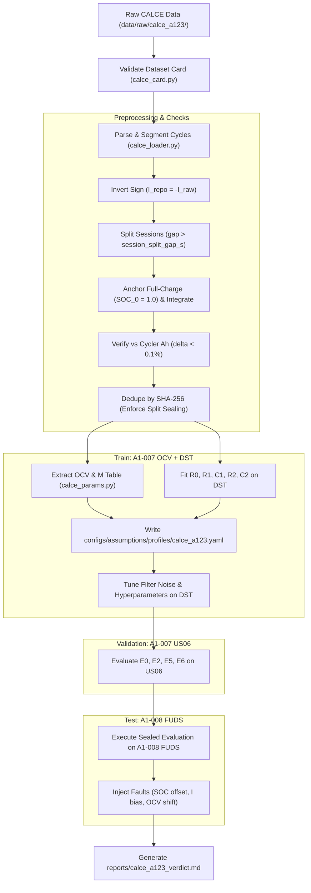

# PLAN_ADAPTER.md: CALCE A123 LFP Real-Data Adapter & Evaluation Pipeline

## 1. Specification Overview & Objectives

This document specifies the technical design, data schema, ingestion pipeline, verification checks, and evaluation protocols for adapting the **CALCE A123 26650 LiFePO4 (LFP)** laboratory dataset into the State-of-Charge (SOC) Estimation Lab.

### Core Architectural Rules
1. **Zero Estimator/Harness Edits:** Estimator implementations (`E0`, `E1`, `E2`, `E5`, `E6`) and harness code under `src/soc/harness/` remain strictly immutable.
2. **Never Commit Raw Data:** Raw experimental spreadsheets under `data/raw/calce_a123/` are ignored by git; all derived profiles and split locks are stored in tracked configuration paths.
3. **AST Constant Prohibition:** All new adapter, loader, and identification code under `src/` must adhere to the AST constant checker (`ALLOWLIST = {0, 1, 2, -1, 3600, 1000, 60}`).

---

## 2. Dataset Card & Hardware Provenance

The loader requires a strictly validated **Dataset Card** before processing any data. If any mandatory field is missing, blank, or unresolved, the loader **refuses to proceed**.

### 2.1 Dataset Card Schema (`src/soc/data/calce_card.py`)
```python
from pydantic import BaseModel, ConfigDict, field_validator

class CalceA123DatasetCard(BaseModel):
    model_config = ConfigDict(extra="forbid")

    # Cell Metadata (Source: Info Sheet & CALCE Documentation)
    cell_manufacturer: str          # "A123 Systems"
    cell_part_number: str           # "ANR26650M1-A"
    cell_format: str                # "26650 cylindrical"
    cell_chemistry: str             # "LiFePO4"
    nominal_capacity_ah: float      # 1.11 Ah
    nominal_voltage_v: float        # 3.3 V
    lower_voltage_cutoff_v: float   # 2.0 V
    upper_voltage_cutoff_v: float   # 3.6 V

    # Cycler Metadata (Source: Arbin BT2000 Technical Datasheet)
    cycler_manufacturer: str        # "Arbin Instruments"
    cycler_model: str               # "BT2000"
    cycler_software: str            # "MITS Pro"
    current_accuracy_pct_fsr: float # 0.02% of full-scale range (FSR)
    voltage_accuracy_pct_fsr: float # 0.02% of full-scale range (FSR)
    voltage_resolution_v: float     # 0.0001 V (16-bit ADC over 5V range)
    current_resolution_a: float     # 0.0001 A

    @field_validator("*")
    def reject_blank_or_none(cls, v, info):
        if v is None or (isinstance(v, str) and not v.strip()):
            raise ValueError(f"Dataset card field '{info.field_name}' cannot be blank or unknown.")
        return v
```

---

## 3. Raw Data Ingestion & Preprocessing

### 3.1 Raw File Structure & Canonical Sheet Resolution
- **File Discovery:** Scans `data/raw/calce_a123/`.
  - Excludes all temporary Microsoft Excel lock files (`~$*`).
  - Supports both modern `.xlsx` and legacy BIFF8 `.xls` formats.
- **Canonical Data Sheet:**
  - In all 36 workbooks, the high-resolution test log is located on the sheet matching prefix `Channel_1-` (`Channel_1-005` or `Channel_1-006`).
  - Auxiliary sheets (`Info`, `Channel_Chart`, `Sheet1`, `Sheet2`) are never used for time-series extraction.
- **Specimen Mapping:**
  - Dynamic Tests: `A1-007` $\to$ `Channel_1-006`, `A1-008` $\to$ `Channel_1-005`.
  - OCV Tests: `A1-007` $\to$ `Channel_1-005`, `A1-008` $\to$ `Channel_1-006` (except $25^\circ\text{C}$ where mapping is inverted).
  - *Rule:* The loader identifies sheets by matching `Channel_1-` dynamically and cross-checking cell IDs from the filename/folder structure.

### 3.2 Canonical $20^\circ\text{C}$ Dataset Selection
- At $20^\circ\text{C}$, the legacy 2012-08-09 test executed an inverted schedule (`FUDS` $\to$ `DST` $\to$ `US06`).
- On 2012-08-17, CALCE re-tested $20^\circ\text{C}$ with the standard schedule `A1-DST-US06-FUDS-20120809.sdu`.
- **Rule:** The adapter ingests `A1-007-DST-US06-FUDS-20-20120817.xlsx` and `A1-008-DST-US06-FUDS-20-20120817.xlsx`. The 2012-08-09 legacy `.xls` files are quarantined.

### 3.3 Sign Convention Inversion
- **Raw Arbin Convention:** Charge is positive ($I > 0$), Discharge is negative ($I < 0$).
- **Harness & Simulator Convention:** Discharge is positive ($I > 0$), Charge is negative ($I < 0$).
- **Mandatory Transformation:**
  $$I_{\text{repo}}(t) = -I_{\text{raw}}(t)$$

### 3.4 Session Splitting & Discontinuity Handling
- **Split Gap Threshold:** Controlled by `run.session_split_gap_s` (declared in assumptions with units and note, default $300.0\,\text{s}$).
- **Condition:** If $\Delta t = t_k - t_{k-1} > \text{run.session\_split\_gap\_s}$:
  - Terminate the current session segment and start a new session segment.
  - **Strict Prohibition:** *No time reconstruction, no artificial interpolation, and no dropout padding.*
- **$10^\circ\text{C}$ OCV Interruption Rule:**
  - At row 5449 of both $10^\circ\text{C}$ OCV files, a 6-hour hardware pause occurred during the discharge branch ($03:17$ to $09:25$ on 2012-06-12), resulting in a non-monotonic time jump ($-94\,\text{s}$) and $+24\,\text{mV}$ relaxation.
  - **Rule:** Segments crossing this $10^\circ\text{C}$ interruption are explicitly **excluded from OCV parameter fitting**.

---

## 4. Ground Truth Reference SOC

### 4.1 Full-Charge CV-End Anchor
Each dynamic drive cycle is preceded by a full CC-CV charge and relaxation:
- Step 4 (or 12, 20): CC charge at 1C ($+1.1\,\text{A}$) to $3.60\,\text{V}$.
- Step 5 (or 13, 21): CV charge hold at $3.60\,\text{V}$ until current decays to $\text{C}/20$ cutoff ($0.055\,\text{A}$).
- Step 7 (or 15, 23): Pre-cycle relaxation rest ($115\,\text{s}$ at zero current).
- **Rule:** Every dynamic profile starts strictly anchored at:
  $$\text{SOC}(t_0) = 1.0000$$

### 4.2 Normalization by Temperature-Dependent $\text{C}/20$ Capacity
Reference SOC is computed by continuous Coulomb counting normalized to the measured low-current $\text{C}/20$ discharge capacity $Q_{\text{C/20}}(T)$ from Step 5 of the corresponding temperature's OCV test:
$$\text{SOC}_{\text{ref}}(t) = 1.0 - \frac{1}{3600 \cdot Q_{\text{C/20}}(T)} \int_{t_0}^t I_{\text{repo}}(\tau) \, d\tau$$

### 4.3 Prohibition of Empty Anchor & Final SOC Reporting
- **Strict Prohibition:** *No empty anchor and no forced closure to 0.* High dynamic discharge currents hit the $2.0\,\text{V}$ lower cutoff before all thermodynamic capacity can be discharged due to internal resistance ($IR$) polarization.
- **Reporting Requirement:** The adapter calculates and reports the unforced final SOC ($\text{SOC}_{\text{end}}$) at the cutoff point for every cycle.
  - At $25^\circ\text{C}$: $\text{SOC}_{\text{end}} \approx 0.025 - 0.035$.
  - At $-10^\circ\text{C}$: $\text{SOC}_{\text{end}} \approx 0.27 - 0.59$.

---

## 5. Data Integrity & Verification Checks

### 5.1 Cycler Capacity Consistency Check
The adapter integrates current and compares it directly against the hardware cycler's logged capacity columns:
- Cycler net discharged capacity:
  $$\Delta Q_{\text{cycler}} = \Delta(\text{Discharge\_Capacity}) - \Delta(\text{Charge\_Capacity})$$
- Our numerical integration:
  $$\Delta Q_{\text{integrated}} = \frac{1}{3600} \sum_{k} I_{\text{repo}}[k] \cdot \Delta t[k]$$
- Discrepancy metric:
  $$\delta Q = \Delta Q_{\text{integrated}} - \Delta Q_{\text{cycler}}$$
- **Rule:** Report $\delta Q$ (in Ah and percentage) per cycle. The loader asserts:
  $$\frac{|\delta Q|}{\Delta Q_{\text{cycler}}} < 0.001 \quad (0.1\%)$$

### 5.2 Cycle Deduplication by Parsed Data SHA-256
Deduplication is performed on the **parsed numeric time-series**, not on file bytes, to ensure that identical datasets in different file envelopes (or duplicate sheets) are caught.
1. **Canonical Byte Stream:** For each extracted cycle, serialize the contiguous array $[t, I_{\text{repo}}, V, T]$ to float64 IEEE 754 little-endian binary bytes.
2. **Hash Computation:** Compute $\text{SHA-256}(\text{bytes})$.
3. **Split Contamination Assertion:**
   $$\text{Train} \cap \text{Val} = \emptyset, \quad \text{Train} \cap \text{Test} = \emptyset, \quad \text{Val} \cap \text{Test} = \emptyset$$
   If any cycle hash appears in more than one split, the loader immediately raises a `ValueError` and aborts.

---

## 6. Schema Bounds Widening

The existing schema in `src/soc/assumptions/schema.py` and defaults in `configs/assumptions/base.yaml` were configured for a large $100\,\text{Ah}$ prismatic cell ($R_0 \approx 1\,\text{m}\Omega$). Small $1.11\,\text{Ah}$ cylindrical 26650 cells have significantly higher internal resistance ($80 - 150\,\text{m}\Omega$) and lower capacity.

The schema bounds are widened with mandatory reason strings:

| Parameter | Previous Bounds | Widened Bounds | Reason String |
| :--- | :---: | :---: | :--- |
| `plant.nominal_capacity_Ah` | $[1.0, 500.0]$ | $[0.1, 500.0]$ | `"Support small sub-1Ah cells and low-temperature LFP cells (e.g. A123 26650 delivering 0.4-1.1 Ah at sub-zero temperatures)."` |
| `plant.r0_table_ohm` | $[0.0001, 0.05]$ | $[0.0001, 0.50]$ | `"Support small cylindrical cells (e.g. A123 26650 with R0 ~ 80-150 mOhm at low temperatures vs large 100Ah prismatic cells with R0 ~ 1 mOhm)."` |
| `plant.r1_table_ohm` | $[0.00005, 0.05]$ | $[0.00005, 0.50]$ | `"Support small cylindrical cells with higher polarization resistance R1 up to 100-200 mOhm."` |
| `plant.r2_table_ohm` | $[0.00005, 0.05]$ | $[0.00005, 0.50]$ | `"Support small cylindrical cells with second RC polarization resistance R2 up to 100-200 mOhm."` |

---

## 7. Experimental Splits & Phased Evaluation Matrix

### 7.1 First-Pass Scope
- **Temperatures:** $20^\circ\text{C}, 25^\circ\text{C}, 30^\circ\text{C}$.
- **Cells:** Both specimens (`A1-007` and `A1-008`).

### 7.2 Sealed Split Assignment
To evaluate genuine cross-profile and cross-specimen transfer, the data is partitioned into strictly sealed splits:

| Split | Cell Specimen | Profile Type | Purpose & Access Rules |
| :--- | :---: | :---: | :--- |
| **Train** | `A1-007` | Low-current OCV ($\text{C}/20$) + DST (Step 8) | Parameter identification (2RC + OCV/hysteresis) and filter tuning. |
| **Validation** | `A1-007` | US06 (Step 16) | Hyperparameter verification and estimator variant selection. |
| **Sealed Test** | `A1-008` | FUDS (Step 24) | **Sealed blind test.** Evaluates physical transfer across both drive cycle and cell hardware. Never accessed during tuning. |

---

## 8. Parameter Identification & Measured Temperature Indexing

### 8.1 Measured Temperature Indexing
Parameter tables ($V_{\text{ocv}}$, $R_0$, $R_1$, $C_1$, $R_2$, $C_2$) in `configs/assumptions/profiles/calce_a123.yaml` are indexed by **measured temperature** from `Temperature (C)_1`, rather than nominal incubator setpoints:
- $20^\circ\text{C}$ Nominal $\longrightarrow$ `"21.5"`
- $25^\circ\text{C}$ Nominal $\longrightarrow$ `"26.6"`
- $30^\circ\text{C}$ Nominal $\longrightarrow$ `"30.6"`

### 8.2 Parameter Identification Methodology (`src/soc/identification/calce_params.py`)
1. **OCV Curve & One-State Hysteresis ($M$):**
   - Extracted from Step 7 ($\text{C}/20$ charge) and Step 5 ($\text{C}/20$ discharge):
     $$V_{\text{ocv}}(\text{SOC}) = \frac{V_{\text{chg}}(\text{SOC}) + V_{\text{dis}}(\text{SOC})}{2}$$
     $$M(\text{SOC}) = \frac{V_{\text{chg}}(\text{SOC}) - V_{\text{dis}}(\text{SOC})}{2}$$
   - Monotonic smoothing ensures $dV_{\text{ocv}}/d\text{SOC} > 0$ strictly across all SOC grid points.
2. **2RC Parameter Fitting ($R_0, R_1, C_1, R_2, C_2$):**
   - Fitted from DST dynamic pulses and relaxation steps using bounded nonlinear least squares (`scipy.optimize.least_squares`).
   - Derived quantities: $\tau_1 = R_1 C_1$, $\tau_2 = R_2 C_2$.
3. **Assumptions Status:** All identified entries in `configs/assumptions/profiles/calce_a123.yaml` are stamped with status `"measured"`.

---

## 9. Parameter Gap Analysis (Unobserved Quantities in CALCE A123)

The following model parameters have **no direct excitation data** in the CALCE A123 dataset and must be documented as assumptions:

| Parameter | Status | Missing Excitation / Reason |
| :--- | :---: | :--- |
| **Minor-Loop Hysteresis Rate ($\gamma$)** | `assumed` | The dataset contains only full-envelope $\text{C}/20$ charges and discharges ($0\% \leftrightarrow 100\%$). No partial minor-loop reversal cycles (e.g., $40\% \to 60\% \to 45\%$) exist to identify the transition decay rate $\gamma$. |
| **SOC-Dependent Pure Diffusion ($R_2, C_2$ at equilibrium)** | `fitted` | The dataset lacks standard HPPC steps (10 s pulses with 5 min rests across 5% SOC increments). RC parameters are identified dynamically from DST pulse trains rather than equilibrium HPPC relaxation. |
| **Coulombic Efficiency ($\eta$) vs. C-rate** | `assumed` | No systematic coulometric round-trip tests were conducted at varying rates to separate Faradaic efficiency from parasitic side reactions. Set to 0.999. |
| **Electro-Thermal Model ($C_{\text{th}}, R_{\text{th}}$)** | `placeholder` | Tests were run in thermal chambers without core temperature sensors or surface heat-flux calorimetry; internal core-to-surface thermal parameters cannot be observed. |

---

## 10. Execution & Evaluation Workflow



---

## 11. Implementation Deliverables & Verification Checklist

- [ ] `src/soc/data/calce_card.py`: Dataset Card schema and strict validator.
- [ ] `src/soc/data/calce_loader.py`: Cycle parser, sign inverter, session splitter, and reference SOC calculator.
- [ ] `src/soc/identification/calce_params.py`: OCV and 2RC parameter identification.
- [ ] `src/soc/assumptions/schema.py`: Widened schema bounds for capacity and resistances with reason strings.
- [ ] `configs/assumptions/base.yaml`: Added `run.session_split_gap_s` parameter entry.
- [ ] `configs/assumptions/profiles/calce_a123.yaml`: Identified parameters indexed by measured temperature.
- [ ] `tests/test_calce_loader.py`: Unit test suite covering cycler capacity consistency, session splitting, SHA-256 deduplication, and schema validation.
- [ ] `scripts/evaluate_calce.py`: Automated pipeline for train fitting, validation, and sealed test execution.
- [ ] `reports/calce_a123_verdict.md`: Final verdict report with transfer metrics and pass/fail summary.
