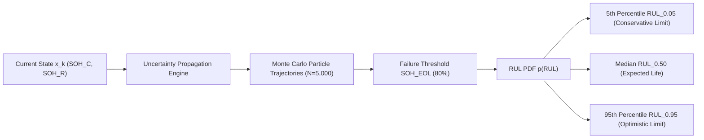
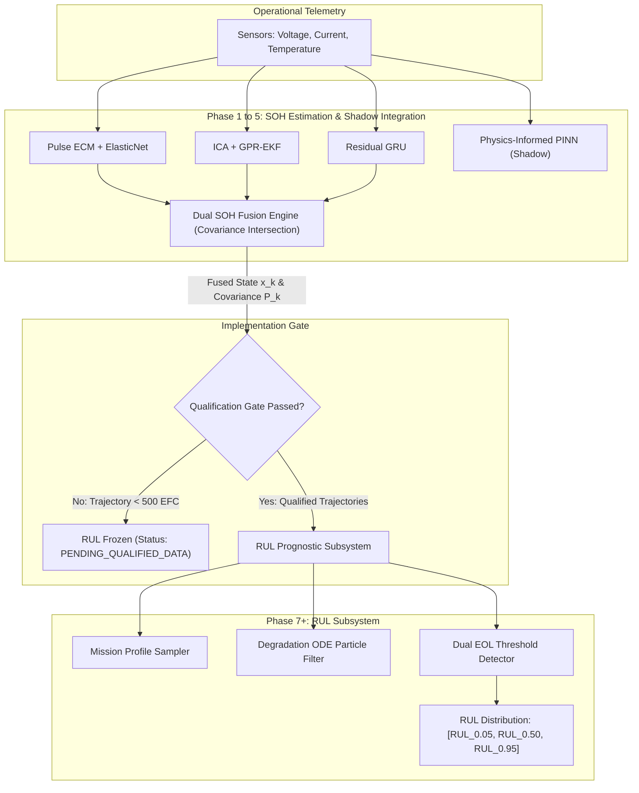

# Remaining Useful Life (RUL) Subsystem Architectural Specification

**Document Version:** 1.0.0-PROPOSAL  
**Status:** DRAFT SPECIFICATION (IMPLEMENTATION FROZEN)  
**Author:** Antigravity Battery Intelligence Engineering  
**Target Milestone:** Phase 7+ (Pending Long-Horizon Trajectory Qualification)  

---

## 1. Executive Summary & Implementation Constraints

This document defines the production architecture for the Remaining Useful Life (RUL) prognostic subsystem of the battery management platform. In accordance with strict engineering governance:

> [!IMPORTANT]
> **Implementation Freeze & Design Scope:** RUL is design only (no runnable code exists in `src/soh`). RUL estimation algorithms must NOT be implemented or promoted into production until sufficiently long, standardized degradation trajectories (>500 equivalent full cycles with documented end-of-life knee rollover) are independently qualified and verified.

The RUL subsystem operates downstream of the SOH State Estimation & Fusion Layer. While SOH tracks the battery's *current health state* ($\mathbf{x}_k = [SOH_C, SOH_R]^T$), RUL projects the *future time evolution* of the health trajectory to determine the remaining operational horizon before functional retirement.

---

## 2. Formal Definitions & End-of-Life (EOL) Failure Criteria

Remaining Useful Life at current operating time $t$ is defined as the time interval $\Delta t_{\text{EOL}}$ until the health state $\mathbf{x}(t)$ breaches an application-specific functional failure boundary:

$$RUL(t) = \inf \left\{ \Delta t \ge 0 \;\middle|\; SOH_C(t + \Delta t) \le SOH_{C,\text{EOL}} \quad\text{or}\quad SOH_R(t + \Delta t) \le SOH_{R,\text{EOL}} \right\}$$

RUL is parameterized across two complementary operational units:
1. **Cycle RUL ($RUL_{\text{cycle}}$):** Remaining Equivalent Full Cycles (EFC) until failure.
2. **Calendar RUL ($RUL_{\text{calendar}}$):** Remaining calendar time (days/months/operating hours) until failure.

### 2.1 Standardized Failure Criteria Matrix

| Application Domain | Chemistry | Capacity EOL ($SOH_{C,\text{EOL}}$) | Resistance EOL ($SOH_{R,\text{EOL}}$) | Physical Failure Mode Justification |
|---|---|---|---|---|
| **Passenger EV (Traction)** | NMC-811 / Graphite | **80.0%** ($0.80 \, Q_0$) | **50.0%** ($R_{\text{actual}} \ge 2.0 \, R_0$) | Acceleration power fade, voltage slump during peak discharge, thermal dissipation limits. |
| **BESS (Grid Energy Storage)** | LFP / Graphite | **70.0%** ($0.70 \, Q_0$) | **50.0%** ($R_{\text{actual}} \ge 2.0 \, R_0$) | Round-trip efficiency ($RTE < 85\%$), thermal runaway safety margin before rapid rollover. |
| **Commercial Heavy Duty** | LFP / Graphite | **75.0%** ($0.75 \, Q_0$) | **60.0%** ($R_{\text{actual}} \ge 1.67 \, R_0$) | Rigorous daily range guarantee, regenerative braking absorption limit. |
| **Second-Life BESS** | LFP / Retired EV | **60.0%** ($0.60 \, Q_0$) | **40.0%** ($R_{\text{actual}} \ge 2.5 \, R_0$) | Low C-rate peak shaving; operates under stringent thermal derating. |

---

## 3. Dual-State RUL Formulation

### 3.1 Capacity-Based RUL ($RUL_C$)
Capacity loss over future cycle interval $\tau$ combines steady-state SEI growth with nonlinear knee-point acceleration:

$$SOH_C(t + \tau) = SOH_C(t) - \int_0^\tau \dot{Q}_{\text{loss}}(t + u) \, du$$

The degradation velocity $\dot{Q}_{\text{loss}}$ is governed by:
$$\dot{Q}_{\text{loss}}(u) = \underbrace{\frac{k_{\text{SEI}}}{2 \sqrt{u}} \cdot \text{Arrh}(T) \cdot g(I, \text{SOC})}_{\text{Phase 1: Parabolic Passivation}} + \underbrace{k_{\text{linear}} \cdot \text{Arrh}(T)}_{\text{Phase 2: Cyclic Wear}} + \underbrace{\frac{k_{\text{knee}}}{1 + \exp\left(-\frac{u - u_{\text{knee}}}{w_{\text{knee}}}\right)}}_{\text{Phase 3: Lithium Plating / Mechanical Cracking}}$$

Capacity-based RUL is obtained by solving:
$$SOH_C(t + RUL_C) = SOH_{C,\text{EOL}}$$

### 3.2 Resistance-Based RUL ($RUL_R$)
In high-power and cold-temperature operations, internal resistance growth often causes the cell to hit inverter cutoff voltage limits long before capacity drops to 80%:

$$R_{\text{total}}(t + \tau) = R_{\text{bulk}}(T) + \Delta R_{\text{SEI}}(\tau) + \Delta R_{\text{contact}}(\tau) + \Delta R_{\text{elyte}}(\tau)$$

Resistance-based health state is tracked as:
$$SOH_R(t + \tau) = \frac{R_{\text{total}}(0)}{R_{\text{total}}(t + \tau)}$$

Resistance-based RUL is the first passage time:
$$SOH_R(t + RUL_R) = SOH_{R,\text{EOL}}$$

### 3.3 Coupled System RUL
The governing pack RUL is the minimum of capacity and resistance limitations:
$$RUL(t) = \min \left( RUL_C(t), \; RUL_R(t) \right)$$

---

## 4. Coupled Cycle-Life and Calendar-Life Prediction

Real-world battery assets spend over 90% of their operational life at rest (parking, grid float). The RUL engine must decouple and recombine cycling wear and calendar aging:

$$\Delta Q_{\text{total}}(t) = \Delta Q_{\text{calendar}}(t_{\text{rest}}, T_{\text{float}}, \text{SOC}_{\text{float}}) + \Delta Q_{\text{cycling}}(N_{\text{cycles}}, \text{DoD}, I_{\text{chg}}, T_{\text{op}})$$

### 4.1 Calendar Fade Kinetics
$$\Delta Q_{\text{calendar}}(t) = k_{\text{cal}} \cdot t^{z_{\text{cal}}} \cdot \exp\left(-\frac{E_{a,\text{cal}}}{R T}\right) \cdot \exp(\alpha_{\text{SOC}} \cdot \text{SOC})$$
- Exponent $z_{\text{cal}} \approx 0.5$ (diffusion-controlled SEI growth).
- Strong exponential acceleration with float SOC $> 80\%$ and float temperature $> 35^\circ\text{C}$.

### 4.2 Dynamic Cycling Fade Kinetics
$$\Delta Q_{\text{cycling}}(N) = k_{\text{cyc}} \cdot N^{z_{\text{cyc}}} \cdot \text{DoD}^{\beta_{\text{DoD}}} \cdot \exp\left(-\frac{E_{a,\text{cyc}}}{R T}\right) \cdot \left[1 + \gamma_{\text{chg}} \left(\frac{I_{\text{chg}}}{1\text{C}}\right)^2\right]$$

---

## 5. Prognostic Degradation Trajectory Uncertainty

Point estimates of RUL are fundamentally dangerous for safety-critical BMS operations. RUL must be delivered as a calibrated **Probability Density Function (PDF)** $p(RUL_t)$ with rigorous confidence bounds.



### 5.1 Uncertainty Sources Accounted For
1. **State Estimation Uncertainty:** Covariance $\mathbf{P}_k$ from the multi-estimator fusion layer.
2. **Model Parameter Uncertainty:** Bayesian posterior distributions over kinetic coefficients $\theta = [k_{\text{SEI}}, E_a, u_{\text{knee}}]$.
3. **Future Mission Profile Uncertainty:** Stochastic variability in future ambient temperatures, charging habits, and route topography.

### 5.2 Particle Filter / Sequential Monte Carlo (SMC) Propagation
A swarm of $P = 5,000$ state particles $\{\mathbf{x}_k^{(i)}, \theta^{(i)}\}_{i=1}^P$ is projected forward in time under Monte Carlo mission profiles. For each particle, the first-passage time $\tau_{\text{EOL}}^{(i)}$ is recorded:
$$\tau_{\text{EOL}}^{(i)} = \min \left\{ \tau \;\middle|\; SOH_C^{(i)}(t + \tau) \le 0.80 \right\}$$

The delivered prognostic output comprises:
- $RUL_{0.05}$ (Conservative / lower 95% bound for warranty and replacement dispatch).
- $RUL_{0.50}$ (Expected remaining life).
- $RUL_{0.95}$ (Upper confidence bound).
- Full empirical hazard function $\lambda(t) = \frac{p(RUL = t)}{1 - P(RUL < t)}$.

---

## 6. Architecture & Interfaces with Existing Subsystems



### 6.1 Proposed Data Contract: `RulEstimate`
```python
@dataclass
class RulEstimate:
    """Prognostic Remaining Useful Life output contract."""
    timestamp_s: float
    current_cycle_index: int
    rul_cycles_median: float
    rul_cycles_p05: float           # 5th percentile (conservative)
    rul_cycles_p95: float           # 95th percentile
    rul_calendar_days_median: float
    governing_mode: str             # "CAPACITY_LIMIT" or "RESISTANCE_LIMIT"
    eol_capacity_threshold: float   # e.g. 0.80
    eol_resistance_threshold: float # e.g. 0.50
    knee_point_risk_score: float    # Probability of knee-point onset within next 100 cycles
    status: EstimationStatus
```

---

## 7. Qualification Gates for Implementation Activation

The RUL subsystem shall remain strictly in specification status until all of the following empirical conditions are verified:

1. **Cohort Trajectory Length:** Access to datasets containing $\ge 20$ cells cycled to functional end-of-life ($SOH_C \le 80\%$) under known operational profiles.
2. **Knee-Point Precursor Validation:** Demonstration that physical or statistical features (e.g., differential voltage peak broadening or 2-RC relaxation asymmetry) can detect onset of rapid rollover $\ge 50$ cycles prior to failure.
3. **Calibrated Interval Coverage:** Prognostic prediction intervals must achieve $\ge 90\%$ empirical coverage on held-out test batteries under strict Leave-One-Battery-Out cross-validation.
4. **Computational Budget:** Particle projection algorithms must execute within $< 200\,\text{ms}$ on embedded automotive edge hardware (Cortex-M7 / Cortex-R5).
