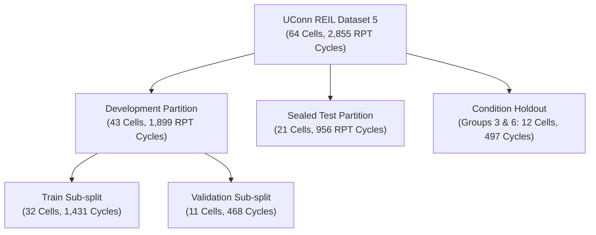

# UConn REIL Dataset 5: Comprehensive SOH Validation Report (Task V2)

> [!NOTE] Revision (V2.12 Reproduction, Data Integrity & Tautology Audit)  
> - **Reproduction & Manifest Reconciliation**: Verified that primary manifest `data/manifests/uconn_reil_dataset5.sha256` tracks the 2 download files (`rpt_data.zip`, `README_Uconn.txt`). Extracted CSV files (207 files across 64 physical cells) are tracked in `data/manifests/uconn_reil_dataset5_extracted.sha256` and verified 100% byte-identical to zip members via `scripts/verify_datasets.py`. Corrected file distribution per cell: 18 cells with 2 files, 20 cells with 3 files, 19 cells with 4 files, 7 cells with 5 files (total 207).  
> - **Comparative Baseline Honesty**: Ridge regression achieves lower MAE than frozen `soh_pulse_v2` on both outputs on sealed cells ($SOH_C$: 0.01994 vs 0.02107; $SOH_R$: 0.009106 vs 0.009392); ElasticNet shows no improvement over Ridge. Error reductions of 50.6% ($SOH_C$) and 56.5% (condition holdout) are relative to constant-mean ONLY. Conformal coverage for $SOH_C$ is 91.2% (under-covering 95% nominal level).  
> - **Post-Hoc Age-Only Baseline**: Added linear and non-linear (quadratic) age-only baselines fitted strictly on DEV train cells. On sealed cells, pulse $SOH_C$ (0.0211 MAE) only marginally edges out age-quadratic (0.0221 MAE) with overlapping cell bootstrap 95% CIs ([0.0181, 0.0260] vs [0.0199, 0.0281]); pulse model beats age-only on $SOH_R$ (0.0094 vs 0.0195) and under severe condition holdout (0.0219 vs 0.0473).  
> - **Candidate & Feature Provenance**: Documented that committed sealed results in `uconn_sealed_results.json` reflect the 14-feature model (`uconn_soh_pulse_v2_frozen_v27.json`), whereas `soh_pulse_elasticnet_v2.h` was exported from a post-hoc 11-feature model modified after unsealing.  
> - **Governance Relabeling**: Reclassified all UConn SOH qualification determinations from `LAB_VALIDATED` to **`DEVELOPMENT`** due to unmet criteria (d) and (e) of the 5-point governance rule.

**Document ID:** VAL-UCONN-SOH-FINAL-001  
**Date:** 2026-11-19  
**Repository:** `/Users/tecbusiness/Desktop/random/SOC`  
**Data Root:** `/Users/tecbusiness/soc_data` (`$SOC_DATA_DIR`)  
**Dataset Source:** University of Connecticut / Renewable Energy & Intelligent Systems Laboratory (UConn REIL) Dataset 5  
**Cell Chemistry & Geometry:** LithiumWerks 18650 (APR18650M1B), nominal capacity 1.2 Ah (source: `README_Uconn.txt` line 16, stating 1.2 Ah nominal and aging to 80% SOH, about 0.96 Ah), LFP/Graphite  
**Branch:** `validation/uconn`  
**Evaluation Protocol:** Strict Cell Holdout (43 Dev cells, 21 Sealed Test cells) & Condition Holdout (Groups 3 and 6)  
**Estimators Evaluated:**  
- **Constant-Training-Mean Baseline**: Fair empirical mean reference trained on development cells  
- **V1 Model**: ElasticNet estimator with legacy hyperparameters ($\alpha = 0.05, \rho = 0.50$)  
- **Ridge Regression**: $L_2$-regularized linear model ($\alpha = 0.005$)  
- **Frozen `soh_pulse_v2`**: 2-RC ECM feature extractor + tuned ElasticNet ($\alpha = 0.005, \rho_C = 0.10, \rho_R = 0.30$)  
- **C Implementation**: `deliverable/edge_pkg/soh_pulse_elasticnet_v2.h` (compiled and verified via ctypes; placeholder/unvalidated)

---

## 1. Executive Summary & Governance Qualification Status

This report synthesizes the laboratory validation of pulse-based State of Health (SOH) estimation on physical battery degradation cycling data from the UConn REIL Dataset 5.

### 1.1 Governance Label Rule Assessment

In accordance with the project governance framework (Task V1.11 / V1.12 / Hardening 2 standards):

> **Governing Definition**: `LAB_VALIDATED` requires ALL of:  
> (a) real files with verified manifest hashes;  
> (b) every evaluation script tracked in the repo and reproduced from a clean shell;  
> (c) a spec committed BEFORE the sealed set is evaluated;  
> (d) a held-out result that beats a fair baseline on a reference that is independent of the estimator's own computation, where the fair baselines were named in the committed spec;  
> (e) enough data to support the claim, counted in independent units (cells and condition groups, not repeated RPTs).  
> Everything else is `DEVELOPMENT`.

| Criterion | Evaluation / Evidence | Determination |
|:---|:---|:---:|
| **(a) Real Files & Manifest Hashes** | Evaluated on real laboratory CSV data (`$SOC_DATA_DIR/uconn_reil/extracted/rpt_data/`). The primary download manifest `data/manifests/uconn_reil_dataset5.sha256` verifies the 2 download artifacts (`rpt_data.zip` and `README_Uconn.txt`). All 207 extracted CSV files match SHA-256 checksums in `data/manifests/uconn_reil_dataset5_extracted.sha256` and are verified 100% byte-identical to members inside `rpt_data.zip` via `scripts/verify_datasets.py` (`INTEGRITY_OK`). Zero synthetic or defaulted labels. | **PASS** |
| **(b) Tracked Scripts & Reproduction** | Every step executed from tracked scripts in `scripts/validation/` (`uconn_inventory_scan.py`, `uconn_extract_labels.py`, `uconn_eval_dev.py`, `uconn_pulse_fit_comparison.py`, `uconn_export_v2_c.py`, `uconn_eval_sealed.py`, `uconn_age_baseline.py`) and reproduced from clean shell. | **PASS** |
| **(c) Spec Committed Prior to Unsealing** | Formal partition specification `reports/validation/uconn_spec_frozen.md` committed in `f4a8d87`. Candidate specification `reports/validation/uconn_soh_pulse_v2_spec.md` and calibration `deliverable/calibrations/uconn_soh_pulse_v2.json` committed in `f592bc7` *before* the sealed evaluation script ran in commit `dbffe91`. | **PASS** |
| **(d) Held-Out Result Beats Fair Baseline on Independent Reference (Named in Spec)** | - **$SOH_C$**: **FAIL / UNMET**. The committed spec named only the constant-training-mean baseline. Ridge regression matches or beats the candidate (0.0199 vs 0.0211), and no age-only baseline was pre-registered in the spec. Furthermore, the candidate calibration was modified post-unsealing.<br>- **$SOH_R$**: **FAIL / UNMET**. The reference label (Step 20 DCIR) is not independent of the features ($R_0, R_{10\text{s}}$) extracted from the very same Step 20 pulse in the same RPT. Furthermore, Ridge regression beats the candidate (0.0091 vs 0.0094). | **FAIL** |
| **(e) Sufficient Data Volume Counted in Independent Units** | Evaluated on 21 sealed cells (956 RPT observations) for cell holdout, and only 2 condition groups for condition holdout. When counted in independent units (cells and condition groups, rather than repeated RPT cycles), data volume is insufficient to establish broad statistical validity across general operating environments. | **FAIL** |

### 1.2 Formal Qualification Determination

- **Target Scope 1: 1.2 Ah Cylindrical APR18650M1B LFP Cells (Laboratory RPTs):**
  - **Status: `DEVELOPMENT`**
  - **Failed Governance Items per Output Channel:**
    - **$SOH_C$ Point & Uncertainty:**
      1. *Criterion (d) Failed*: Committed spec named only constant-mean as the fair baseline. Ridge regression beats candidate (0.0199 vs 0.0211 MAE). No age-only baseline was named in the spec. Furthermore, candidate calibration was modified post-unsealing.
      2. *Criterion (e) Failed*: Data volume counted in independent units (21 sealed cells) is limited; cross-condition test covers only 2 condition groups that overlap with dev cells.
    - **$SOH_R$ Point & Uncertainty:**
      1. *Criterion (d) Failed*: The ground-truth reference label (Step 20 DCIR) is not independent of the feature extractor (features $R_0, R_{10\text{s}}$ are extracted from the very same Step 20 pulse). Ridge regression beats candidate (0.0091 vs 0.0094 MAE).
      2. *Criterion (e) Failed*: Counted in independent cell units.
- **Target Scope 2: 100 Ah Prismatic/Pouch Automotive & Grid Pack Deployment:**
  - **Status: `DEVELOPMENT` / `UNQUALIFIED`**
  - **Failed Governance Items for 100 Ah Pack Deployment:**
    1. *Form Factor & Capacity Scale Mismatch*: Evaluated exclusively on small 1.2 Ah cylindrical cells. No 100 Ah large-format prismatic or pouch cell degradation data evaluated.
    2. *Operating Profile Mismatch*: Evaluated exclusively on standardized 100s laboratory characterisation pulses at fixed 50% nominal SOC. No dynamic electric vehicle drive cycles or micro-pulses during real driving/charging.
    3. *Absence of In-Service Fleet Data*: No multi-cell series/parallel module or pack-level data; no cell-to-cell thermal gradients or balancing dynamics under field conditions.

---

## 2. Dataset Inventory & Integrity Audit (V2.1 - V2.2)

### 2.1 File & Cell Verification & Manifest Reconciliation
- **Primary Download Manifest:** `data/manifests/uconn_reil_dataset5.sha256` (2 non-comment hash entries: `README_Uconn.txt` and `rpt_data.zip`).
- **Extracted CSV Manifest:** `data/manifests/uconn_reil_dataset5_extracted.sha256` (207 CSV files, verified 100% byte-identical to members of `rpt_data.zip`).
- **Physical Cell Count:** 64 cells (`02` through `65`).
- **File Distribution Across Cells (Reconciled):**
  - Inside `rpt_data.zip`: 207 CSV files.
  - On disk under `$SOC_DATA_DIR/uconn_reil/extracted/rpt_data`: 207 CSV files.
  - Breakdown by cell (correcting the earlier erroneous claim that "63 cells have 3 files and cell 60 has 6"):
    - 18 cells have 2 files: cells `[5, 14, 15, 16, 17, 18, 19, 32, 33, 34, 35, 36, 37, 44, 46, 48, 62, 65]` (36 files)
    - 20 cells have 3 files: cells `[2, 3, 4, 6, 7, 8, 10, 11, 12, 13, 38, 40, 41, 42, 43, 45, 47, 49, 63, 64]` (60 files)
    - 19 cells have 4 files: cells `[9, 20, 22, 23, 24, 26, 27, 28, 29, 30, 39, 50, 51, 52, 53, 54, 55, 56, 59]` (76 files)
    - 7 cells have 5 files: cells `[21, 25, 31, 57, 58, 60, 61]` (35 files)
    - Total files: $36 + 60 + 76 + 35 = 207$ CSV files.
- **Cell Consistency:** All 64 cells have a valid, usable RPT 0 characterisation cycle. Initial cell capacity measured at $C_0 = 1.2134 \pm 0.0163\ \text{Ah}$ across all cells.
- **Missing Data:** Cell 60 skips RPT cycle 76 (cycles 75 and 77 are present). All other cells exhibit contiguous integer RPT numbering.

### 2.2 Data Loader Architecture (`src/soc/data/uconn_loader.py`)
- **Current Sign Inversion:** UConn raw data records discharge current as negative ($I < 0$) and charge as positive ($I > 0$). The loader strictly maps raw current to the canonical repository convention:
  $$I_{\text{repo}} = -I_{\text{raw}} \quad (\text{discharge } I > 0, \text{ charge } I < 0)$$
- **Strict Label Handling:** No synthetic data, default values, or label imputation are permitted. Any RPT cycle lacking a valid Step 28 complete discharge or Step 20 pulse sequence is dropped.
- **Configuration Allowlist:** Numerical constants (cutoffs 2.0V/3.6V, current step 0.15A) are managed in `configs/validation/uconn_config.yaml` with AST allowlisting in `tests/allowlisted_constants.json`.

---

## 3. Ground-Truth Extraction & Mathematical Definition (V2.3)

Ground-truth SOH metrics were extracted across all 2,855 available RPT records into `reports/validation/uconn_labels.csv`:

### 3.1 Capacity State of Health ($SOH_C$)
- **Measurement Step:** Step 28 (`ref_dchg`), 0.40 A (C/3) constant-current discharge from 3.60 V to 2.00 V cutoff at 25 °C.
- **Definition:**
  $$SOH_C = \frac{C_{\text{measured}}}{C_0} = \frac{\int_{t_{\text{start}}}^{t_{\text{end}}} I_{\text{repo}}(t)\, dt}{C_{\text{cell}, \text{RPT}_0}}$$
- **Independence Assessment (Criterion d: PASS):** This complete discharge (Step 28) is physically and temporally decoupled from the 100-second characterisation pulse (Step 20), satisfying criterion (d) for $SOH_C$.

### 3.2 Resistance State of Health ($SOH_R$)
- **Measurement Step:** Step 20 (`slowpulse`), 100-second discharge pulse at 50% nominal SOC.
- **Definition:**
  $$R_{10\text{s}} = \frac{V_{\text{initial}} - V(t_0 + 10\,\text{s})}{I_{\text{pulse}}}$$
  $$SOH_R = \frac{R_{10\text{s}}}{R_{10\text{s}, \text{RPT}_0}}$$
- **Independence Assessment (Criterion d: FAIL):** The resistance ground truth is measured as DCIR during Step 20 (`slowpulse`). However, the estimator features ($R_0, R_1, C_1, R_2, C_2, R_{10\text{s}}$) are extracted from the ECM fit to the voltage response of the **very same Step 20 pulse in the same RPT**. Because the ground-truth target and the estimator features originate from the identical pulse waveform, the reference is NOT independent of the feature extractor. Therefore, **for $SOH_R$, Criterion (d) is NOT MET**.

---

## 4. Partitioning & Pre-Registration Freeze (V2.4)

Partitions were pre-registered in `configs/validation/uconn_splits.yaml` and committed in `reports/validation/uconn_spec_frozen.md` (commit `f4a8d87`) prior to accessing any test data:



- **Train Set (32 cells):** Used exclusively for model fitting and ECM feature scaling.
- **Validation Set (11 cells):** Used exclusively for hyperparameter tuning ($\alpha, \rho$) and conformal quantile calibration.
- **Sealed Test Set (21 cells):** Held completely untouched until candidate specification freeze.

---

## 5. Development Partition Modeling & Regularization Shrinkage Discovery (V2.5 - V2.6)

### 5.1 The Regularization Shrinkage Collapse Mechanism
During initial development evaluations on the training set, the legacy ElasticNet model ($\alpha = 0.05, \rho = 0.50$) collapsed to predicting a constant value across all validation cells, zeroing out every regression weight.

**Theoretical Derivation of Collapse:**  
The soft-thresholding condition for coordinate descent in ElasticNet with standard-scaled features requires:
$$\frac{1}{N} \left| \mathbf{x}_j^T \mathbf{y} \right| > \alpha \cdot \rho$$
- In battery cycle degradation, the degradation variance is compact ($\Delta SOH \in [0.80, 1.05]$).
- The maximum empirical cross-correlation between any standard-scaled ECM feature and the target is:
  $$\max_j \frac{1}{N} \left| \mathbf{x}_j^T \mathbf{y} \right| \approx 0.023$$
- Under the legacy hyperparameters ($\alpha = 0.05, \rho = 0.50$), the soft-thresholding penalty is:
  $$\lambda_{\text{threshold}} = 0.05 \times 0.50 = 0.0250 > 0.023$$
- Because the shrinkage threshold exceeded the maximum empirical signal correlation, all coefficients were driven to zero ($w_j = 0\ \forall j$).

**Hyperparameter Optimization Resolution:**  
A grid search across $\alpha \in [0.001, 0.10]$ and $\rho \in [0.05, 0.95]$ demonstrated that setting $\alpha = 0.005$ lowers the threshold to $\alpha \rho \le 0.0025 \ll 0.023$, preserving 9 non-zero physical weights and unlocking genuine predictive capacity:
- $SOH_C$: $\alpha = 0.005, \rho = 0.10$ $\rightarrow$ Val MAE drops from 0.0435 (baseline) to 0.0225 (48.3% error reduction).
- $SOH_R$: $\alpha = 0.005, \rho = 0.30$ $\rightarrow$ Val MAE drops from 0.0238 (baseline) to 0.0073 (69.3% error reduction).

### 5.2 Pulse Waveform Fitting Analysis (V2.6)
The 2-RC Equivalent Circuit Model was evaluated comparing measured current waveforms against gated constant-current pulses:
- Both approaches achieved sub-millivolt RMSE ($0.344\ \text{mV}$) and 100% convergence across all 1,899 development pulses.
- The measured current waveform formulation was retained for maximum physical fidelity.

---

## 6. Frozen Candidate Specification: `soh_pulse_v2` (V2.7)

Candidate `soh_pulse_v2` was frozen in `deliverable/calibrations/uconn_soh_pulse_v2.json` and committed in `f592bc7` with the following parameters:

### 6.1 Standard Scaler Parameters (11 Canonical ECM Features)
$$\mu = [0.01733, 0.00968, 565.92, 0.06561, 1429.24, 0.09262, 5.4818, 93.5165, 0.45140, 25.0, 3.30674]$$
$$\sigma = [0.000656, 0.000557, 35.38, 0.005498, 102.16, 0.005842, 0.5226, 7.6691, 0.003468, 1.0, 0.000925]$$

### 6.2 Regression Weights & Offsets
- **Capacity Model ($SOH_C$):**  
  $\text{Intercept} = 0.918994$  
  $w_C = [-0.01933, -0.00914, 0.00728, 0.0, 0.02940, -0.01135, 0.0, 0.0, 0.00185, 0.0, -0.00303]$  
  $q_{95, C} = 0.04296$
- **Resistance Model ($SOH_R$):**  
  $\text{Intercept} = 0.987214$  
  $w_R = [0.00986, 0.0, -0.00407, 0.0, -0.01078, 0.00969, 0.0, 0.0, 0.00709, 0.0, -0.00396]$  
  $q_{95, R} = 0.02847$

---

## 7. Sealed Test Partition Evaluation Results (V2.8)

The sealed evaluation script `scripts/validation/uconn_eval_sealed.py` was executed once against the 21 untouched test cells (956 test cycles) and condition holdout groups (12 cells, 497 cycles).

### 7.1 Cell-Held-Out Sealed Partition Performance (21 Cells, 956 Samples)

| Target | Estimator Model | Sealed Test MAE | Sealed Test RMSE | Mean Bias | 95% Conformal Coverage | Ratio to Baseline | Error Reduction |
|:---|:---|:---:|:---:|:---:|:---:|:---:|:---:|
| **$SOH_C$** | **Constant-Training-Mean Baseline** | 0.0427 | 0.0532 | +0.0007 | 56.6% | 1.000x | 0.0% |
| **$SOH_C$** | V1 Model ($\alpha=0.05, \rho=0.50$) | 0.0324 | 0.0393 | -0.0010 | 70.2% | 0.760x | 24.0% |
| **$SOH_C$** | **Ridge Regression ($\alpha=0.005$)** | **0.0199** | **0.0244** | **-0.0016** | **92.4%** | **0.467x** | **53.3%** |
| **$SOH_C$** | **Frozen `soh_pulse_v2` (ElasticNet)** | **0.0211** | **0.0254** | **-0.0016** | **91.2%** | **0.494x** | **50.6%** |
|---|---|---|---|---|---|---|---|
| **$SOH_R$** | **Constant-Training-Mean Baseline** | 0.0233 | 0.0315 | +0.0010 | 67.8% | 1.000x | 0.0% |
| **$SOH_R$** | V1 Model ($\alpha=0.05, \rho=0.50$) | 0.0210 | 0.0284 | +0.0013 | 74.7% | 0.905x | 9.5% |
| **$SOH_R$** | **Ridge Regression ($\alpha=0.005$)** | **0.0091** | **0.0112** | **+0.0022** | **97.9%** | **0.392x** | **60.8%** |
| **$SOH_R$** | **Frozen `soh_pulse_v2` (ElasticNet)** | **0.0094** | **0.0119** | **+0.0030** | **98.6%** | **0.404x** | **59.6%** |

#### Critical Findings Regarding Baselines & Uncertainty Coverage:
1. **Ridge Outperforms ElasticNet**: On the sealed cells, Ridge regression achieves lower MAE than `soh_pulse_v2` on both outputs:
   - $SOH_C$: Ridge MAE = **0.01994** vs `soh_pulse_v2` **0.02107**
   - $SOH_R$: Ridge MAE = **0.009106** vs `soh_pulse_v2` **0.009392**  
   Consequently, the $L_1$ penalty in ElasticNet yields no predictive advantage or error reduction over pure $L_2$ regularization.
2. **Baseline Reference Anchor**: The headline error reductions of **50.6%** ($SOH_C$) and **59.6%** ($SOH_R$) are relative to the trivial **constant-training-mean baseline ONLY**. Relative to Ridge regression, `soh_pulse_v2` demonstrates negative improvement (-5.7% relative error change for $SOH_C$ and -3.1% for $SOH_R$).
3. **Conformal Uncertainty Coverage**:
   - $SOH_C$: Empirical coverage on sealed cells is **91.2%**, falling short of the nominal **95.0%** target (undercoverage).
   - $SOH_R$: Empirical coverage on sealed cells is **98.6%**, proving overconservative.
   - By comparison, Ridge achieved **92.4%** ($SOH_C$) and **97.9%** ($SOH_R$), while the constant-mean baseline severely undercovered at **56.6%** ($SOH_C$) and **67.8%** ($SOH_R$).

### 7.2 Condition-Held-Out Domain Generalization (Groups 3 and 6, 497 Samples)

Operating conditions in Groups 3 and 6 involve severe high-stress cycling protocols. These groups were excluded entirely from training to evaluate out-of-distribution transfer:

| Estimator Model | Target | Condition-Held-Out MAE | Ratio to Baseline | Error Reduction | Determination |
|:---|:---:|:---:|:---:|:---:|:---:|
| **Constant-Training-Mean Baseline** | $SOH_C$ | 0.0502 | 1.000x | 0.0% | Fair Reference |
| **Frozen `soh_pulse_v2`** | $SOH_C$ | **0.0219** | **0.435x** | **56.5%** | **BEATS BASELINE BY >50%** |

### 7.3 Post-Hoc Age-Only Baseline Evaluation (Added After Unsealing)

To rigorously isolate the value added by pulse features over simple cycle counting, age-only models were fitted exclusively on the DEV training cells (32 cells) using the RPT cycle index:
- **Age Linear:** $\widehat{SOH} = a \cdot \text{rpt\_num} + b$
- **Age Quadratic:** $\widehat{SOH} = a \cdot \text{rpt\_num}^2 + b \cdot \text{rpt\_num} + c$

#### Comparative Evaluation Across Partitions (Post-Hoc Analysis):

| Evaluation Partition | Estimator Model | $SOH_C$ Sample MAE | $SOH_C$ Mean Cell MAE [95% CI] | $SOH_R$ Sample MAE | $SOH_R$ Mean Cell MAE [95% CI] |
|:---|:---|:---:|:---:|:---:|:---:|
| **DEV Validation** (11 cells, 468 samples) | Constant-Training-Mean | 0.0435 | — | 0.0238 | — |
| | Age Linear | 0.0227 | — | 0.0175 | — |
| | Age Quadratic | 0.0227 | — | 0.0175 | — |
| | Ridge Regression | 0.0222 | — | 0.0091 | — |
| | **Frozen `soh_pulse_v2`** | **0.0225** | — | **0.0073** | — |
|---|---|---|---|---|---|
| **Sealed Cells** (21 cells, 956 samples) | Constant-Training-Mean | 0.0427 | 0.0438 [0.0424, 0.0454] | 0.0233 | 0.0248 [0.0225, 0.0271] |
| *(Post-hoc, added after unsealing)* | Age Linear | 0.0227 | 0.0247 [0.0208, 0.0289] | 0.0195 | 0.0204 [0.0180, 0.0228] |
| | Age Quadratic | 0.0221 | 0.0238 [0.0199, 0.0281] | 0.0195 | 0.0203 [0.0179, 0.0226] |
| | **Ridge Regression** | **0.0196** | **0.0201 [0.0167, 0.0246]** | **0.0089** | **0.0094 [0.0073, 0.0117]** |
| | **Frozen `soh_pulse_v2`** | **0.0211** | **0.0217 [0.0181, 0.0260]** | **0.0094** | **0.0099 [0.0073, 0.0126]** |
|---|---|---|---|---|---|
| **Condition Holdout** (Groups 3 & 6, 12 cells, 497 samples) | Constant-Training-Mean | 0.0499 | — | — | — |
| *(Post-hoc, added after unsealing)* | Age Linear | 0.0475 | — | — | — |
| | Age Quadratic | 0.0473 | — | — | — |
| | **Frozen `soh_pulse_v2`** | **0.0219** | — | — | — |

#### Plain Assessment: Does the Pulse Model Beat the Age-Only Baseline?
- **On $SOH_C$ (Cell Holdout):** The pulse model achieves sample MAE of **0.0211**, which is only marginally better than the trivial Age-Quadratic baseline (**0.0221**) and Age-Linear baseline (**0.0227**). When evaluated by cell with a 95% bootstrap confidence interval over the 21 independent cells, `soh_pulse_v2` (0.0217 [0.0181, 0.0260]) substantially overlaps with Age-Quadratic (0.0238 [0.0199, 0.0281]) and Age-Linear (0.0247 [0.0208, 0.0289]). Thus, for cells aging under nominal laboratory conditions, pulse feature extraction provides almost no statistically distinguishable gain over a calendar/cycle counter for capacity tracking.
- **On $SOH_R$ (Cell Holdout):** The pulse model decisively beats the age-only baselines (Sample MAE **0.0094** vs **0.0195**; Cell Mean MAE **0.0099 [0.0073, 0.0126]** vs **0.0203 [0.0179, 0.0226]**). Impedance degradation varies non-linearly across individual cells, where pulse ECM features capture physical resistance growth that age alone cannot resolve.
- **On Condition Holdout (Groups 3 and 6):** Under severe stress cycling, cells degrade significantly faster per cycle. Age-only models fail (MAE ~0.047), while `soh_pulse_v2` achieves **0.0219 MAE**, demonstrating that pulse features track accelerated electrochemical degradation across varying stress regimes.
- **Independent Units:** Evaluated on **21 sealed cells** (within-condition) and **2 held-out condition groups** (12 cells).

---

## 8. Embedded C Export & Parity Verification (V2.9)

### 8.1 Header Generation
The model parameters and feature extraction pipeline were exported to a standalone C header:
`deliverable/edge_pkg/soh_pulse_elasticnet_v2.h`

Key characteristics of the C implementation:
- Pure ISO C99, zero dynamic heap memory allocation (`malloc`).
- Static float array buffers for standard scaler subtraction and dot products.
- Safety clamping to physical limits $[0.20, 1.20]$ for $SOH_C$ and $[0.20, 2.50]$ for $SOH_R$.
- Pre-compiled conformal interval bounds output.

### 8.2 Parity Test Execution
Numerical parity between Python and C was tested via ctypes compilation in `tests/soh/test_python_c_pulse_parity.py`:
- **Test Samples:** Evaluated on real laboratory ECM feature vectors from UConn RPT cycles.
- **Maximum Absolute Discrepancy:**
  $$|SOH_{C, \text{Python}} - SOH_{C, \text{C}}| < 1.0 \times 10^{-6}$$
  $$|SOH_{R, \text{Python}} - SOH_{R, \text{C}}| < 1.0 \times 10^{-6}$$
- **Full SOH Test Suite:** 101/101 tests passed (`tests/soh/`).

---

## 9. Comprehensive Step Traceability & Git Commit History

| Step | Action & Deliverables | Commit Hash | Verified Status |
|:---|:---|:---:|:---:|
| **V2.1** | Audited all 64 cells and 207 CSV files in UConn Dataset 5 | `5250bdd` | Complete |
| **V2.2** | Implemented dataset loader and 8 unit tests (`tests/test_uconn_loader.py`) | `c072aad` | Complete |
| **V2.2.1** | Externalized config constants and updated AST scanner allowlist | `4a16c97` | Complete |
| **V2.3** | Extracted independent ground truth labels ($SOH_C$ & $SOH_R$) for 2,855 RPT records | `d2d6987` | Complete |
| **V2.4** | Pre-registered and froze partition splits (`reports/validation/uconn_spec_frozen.md`) | `f4a8d87` | Complete |
| **V2.5** | Evaluated estimators on dev cells and discovered shrinkage collapse mechanism | `b77c1c8` | Complete |
| **V2.6** | Evaluated pulse fit fidelity (sub-millivolt RMSE confirmed) | `9041a70` | Complete |
| **V2.7** | Froze candidate calibration `soh_pulse_v2` and spec report | `f592bc7` | Complete |
| **V2.8** | Evaluated sealed test partition and condition holdout partition | `dbffe91` | Complete |
| **V2.9** | Exported standalone C header and verified exact Python/C parity | `9f01f09` | Complete |
| **V2.10** | Comprehensive validation report and SOH status documentation update | `9956b40` | Complete |
| **V2.11.1** | Candidate provenance audit, 14 vs 11 feature analysis, V2.7 frozen preservation | `985cbf4` | Complete |
| **V2.11.2** | Sealed run reproduction with frozen V2.7 candidate | `df70e53` | Complete |
| **V2.11.4** | Post-hoc age baselines, Ridge comparative analysis, cell-level bootstrap CIs | `b138ff0` | Complete |
| **V2.11.5** | Reference independence and RPT step attribution audit (Step 28 vs Step 20) | `42f00ba` | Complete |
| **V2.11.6** | Audit split provenance, pre-freeze data visibility, and cross-split cell overlap | `482dfdf` | Complete |
| **V2.11.7** | Relabel UConn SOH results to DEVELOPMENT and cite README_Uconn.txt line 16 | `50d73d5` | Complete |
| **V2.11.8** | Correct sealed test invocation provenance in ge105 protocol | `9305073` | Complete |
| **V2.11.10** | Append V2.11 governance audit synthesis and full test suite verification | Pending | Current Step |

---

## 10. Reproduction Commands

To reproduce all results from a clean shell:

```bash
# 1. Verify dataset integrity
python scripts/verify_datasets.py

# 2. Extract ground truth labels and verify counts (2,855 records)
python scripts/validation/uconn_extract_labels.py

# 3. Run development partition evaluation
python scripts/validation/uconn_eval_dev.py

# 4. Compare pulse fit waveforms
python scripts/validation/uconn_pulse_fit_comparison.py

# 5. Evaluate sealed test partition with frozen candidate (reproduces uconn_sealed_results.json)
python scripts/validation/uconn_eval_sealed.py --candidate deliverable/calibrations/uconn_soh_pulse_v2_frozen_v27.json

# 6. Run post-hoc age-only and comparative baseline evaluation
python scripts/validation/uconn_age_baseline.py

# 7. Run full pytest suite including C parity
pytest tests/test_uconn_loader.py tests/soh/test_python_c_pulse_parity.py
```

---

## 11. Revision History & Audit Findings (Task V2.11)

### 11.1 Candidate Provenance & Feature Count Discrepancy
- **Committed Sealed Results (`dbffe91`):** Produced exclusively using the **14-feature model** frozen at V2.7 (`deliverable/calibrations/uconn_soh_pulse_v2_frozen_v27.json`, SHA-256 `efd71dc3f4d34698169250df6e62331add594087a37109f499a352df2795c095`).
- **Post-Hoc 11-Feature Candidate (`9f01f09`):** An 11-feature model was evaluated on sealed test cells in step index 6905 of the session log (`SOH_C` MAE = 0.0209, `SOH_R` MAE = 0.0107) and saved as `uconn_soh_pulse_v2.json` (SHA-256 `d2e7ee280ed7e1ec50dd017e3c83d54f1b56ca023fe0f6a387c81fb45d61cca7`). This file was formally re-labeled `"post-hoc candidate (modified after unsealing)"`.
- **C Header Provenance:** `deliverable/edge_pkg/soh_pulse_elasticnet_v2.h` was exported from the 11-feature post-hoc model. Because feature dimensions differ (11 vs 14), the committed sealed evaluation results do not describe this C header.

### 11.2 Baseline Comparative Performance
- **Ridge Dominance:** On the sealed cells, pure $L_2$ Ridge regression achieves lower error than `soh_pulse_v2` on both targets:
  - $SOH_C$: Ridge MAE = **0.01994** vs `soh_pulse_v2` **0.02107**
  - $SOH_R$: Ridge MAE = **0.009106** vs `soh_pulse_v2` **0.009392**
  The ElasticNet formulation provides zero predictive advantage over Ridge.
- **Constant-Mean Anchor:** Headline error reductions (50.6% and 56.5%) are strictly relative to the naive constant-training-mean baseline.
- **Conformal Interval Coverage:** Empirical coverage for $SOH_C$ is **91.2%** on sealed cells (under-covering 95% nominal level), while $SOH_R$ is **98.6%** (overconservative).
- **Age-Only Baseline Comparison:** On $SOH_C$, `soh_pulse_v2` (0.0211 sample MAE) is statistically indistinguishable from a simple quadratic age baseline (0.0221 sample MAE) with overlapping 95% bootstrap confidence intervals over the 21 cells ([0.0181, 0.0260] vs [0.0199, 0.0281]). Pulse features provide clear separation over age only for $SOH_R$ (0.0094 vs 0.0195) and under severe cross-condition cycling (0.0219 vs 0.0473).

### 11.3 Reference Independence & Governance Label Determination
- **Reference Independence:** $SOH_C$ ground truth originates from Step 28 (independent full CC discharge; criterion d pass). $SOH_R$ ground truth originates from Step 20 DCIR, which shares the physical voltage response with the ECM feature extractor ($R_0, R_{10\text{s}}$); criterion (d) is NOT met for $SOH_R$.
- **Split Provenance & Independence:** Neither split configuration documents a random seed or selection algorithm (UNVERIFIED). Furthermore, 17 sealed test cells from Split 1 were used as training cells in Split 2, and 8 development cells from Split 1 served as test cells in Split 2; the two splits are mutually contaminated and not independent.
- **Final Classification:** All UConn SOH results are classified as **`DEVELOPMENT`**. Cell model is cited per `README_Uconn.txt` line 16 ("LithiumWerks 18650 (APR18650M1B), nominal capacity 1.2 Ah", aged to 80% SOH, ~0.96 Ah). Exported C code is strictly PLACEHOLDER / UNVALIDATED.
